# quant_alpha_lab

**An end-to-end research pipeline for cross-sectional equity long-short strategies, built to answer one question honestly: does this signal still work after costs, on data the model never saw?**

It takes raw S&P 500 prices and produces a dollar-neutral, risk-managed portfolio. It then reports a net-of-cost Sharpe ratio with its confidence interval, measured only on a holdout period that was never used to pick, tune or fit anything.

**What makes it different from a typical backtest repo**

- **No look-ahead, by construction and by test.** Signal at the close of t, trade at the open of t+1, label from the same open. A test cuts the prices at a date and checks that no earlier feature changes.
- **Overlapping returns are handled everywhere.** 20-day labels overlap, so the Newey-West lag, the purge and embargo in the cross-validation, and the Sharpe annualisation all account for it.
- **Many signals are tested, so false discoveries are controlled.** Signals are selected with BH, BY and Storey q-value FDR on the search period only.
- **Out-of-fold scores, then one untouched holdout.** The Elastic Net is tuned by combinatorial purged cross-validation.
- **A real risk model.** Marchenko-Pastur cleaning, Ledoit-Wolf shrinkage and Louvain clusters drive the volatility target and the cluster caps.
- **Costs are part of the result.** Half-spread, square-root market impact and commission. The Sharpe is also shown at 2× and 3× costs.
- **Known limits are written down.** Survivorship bias and the unmodelled borrow and financing costs are listed in [section 10](#10-known-limitations).

**Every stage is one script, and every run is reproducible.** Each script reads files and writes files, under a `run_id` that stores the git commit and the hash of the inputs. The logic lives in tested library modules in `src/`. The scripts only call them, in order.

**How it was built.** I use LLMs openly, and I think that is the right way to build software now. Stages 01 to 03 were written mostly by hand, with a light use of LLMs where I read and checked every line. From stage 04 on, most of the code is written by LLMs (Claude, and Nemotron Ultra through Cline), working under my direction. My job is the part a model cannot do for me: the research question, the pipeline design, the statistical choices (what to test, how to correct it, where the holdout starts), and the review. Every bug the review found is listed in [section 11](#11-bugs-found-by-review-and-the-test-that-guards-each) with the regression test that guards it. I also check the code against simulations with a known answer, such as a planted signal with a known IC. I don't need to type every line myself. I need to know what each line must do, and to prove that it does it.

> **No performance number is quoted here.** Run the pipeline and read the holdout block printed by stage 04f ([section 5](#5-quick-start)). It is the only number I trust.

---

## About

**Quentin Le Moal** · PhD in Mathematics (Quantitative Finance), EPFL · Seeking a **Quantitative Researcher** role in Switzerland
📧 qs.lemoal@gmail.com · 🔗 [LinkedIn](https://www.linkedin.com/in/qlemoal/)

---

## 1. What this project does

| Question | Answer |
|---|---|
| Universe | S&P 500 members, daily bars, 2000 to 2026 (Yahoo Finance) |
| Prediction target | Return over the next h = 20 trading days, open to open, one day after the signal |
| Signals | Momentum, volatility, liquidity (beta available), each with a cross-sectional transform |
| Selection | Rank IC, Newey-West t-statistic, false discovery rate control (BH, BY, Storey q-value) |
| Combination | Elastic Net, tuned by Combinatorial Purged CV, scored out-of-fold, checked on a holdout |
| Risk model | Marchenko-Pastur cleaned correlation, Ledoit-Wolf shrinkage, Louvain clusters |
| Portfolio | Dollar-neutral, cluster caps, 10% volatility target, leverage cap |
| Backtest | Trade at the next open, weights drift, spread + square-root impact + commission |
| Headline number | Net Sharpe on the **holdout**, with its 95% interval |

---

## 2. The pipeline at a glance

Each stage, with the question it answers and the file it writes:

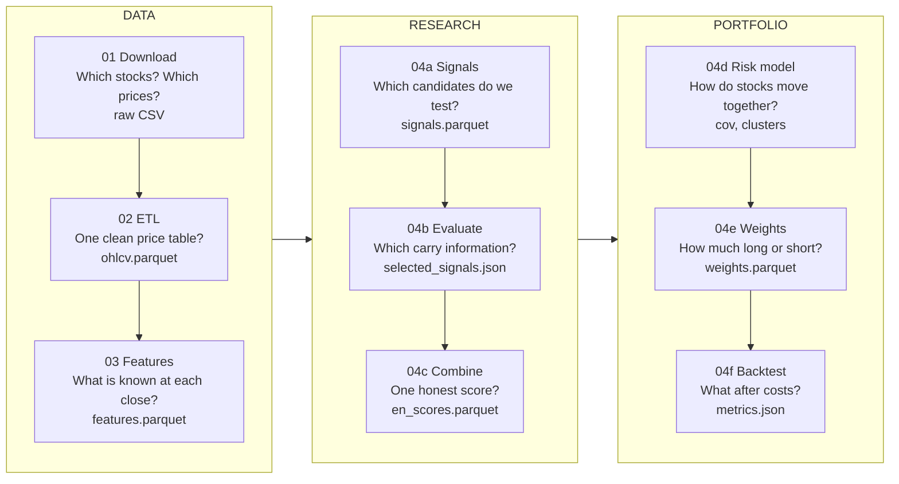

| Stage | Script |
|---|---|
| 01 | `scripts/pipeline/01_download_data.py` |
| 02 | `scripts/pipeline/02_etl_prices.py` |
| 03 | `scripts/pipeline/03_build_features.py` |
| 04a to 04f | `scripts/pipeline/04a_generate_signals.py` … `04f_run_backtest.py` |
| 04a to 04f in one command | `scripts/pipeline/04_run_all.py` |

---

## 3. The one rule: no look-ahead

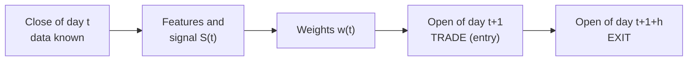

```
 day:       t                t+1                              t+1+h
            |                 |                                 |
 data up to |  features,      | trade at this open              | label ends here
 this close |  signal, weights|                                 |
            +-----------------+---------------------------------+
                              label = log(open[t+1+h]) - log(open[t+1])
```

- A feature at date t uses data up to the **close of t**. Nothing later.
- The trade is at the **open of t+1**. The label starts at the same open.
- Signal, label and profit use the same clock. A test cuts the prices at a date and checks that no earlier feature changes (`tests/test_features.py`).
- Labels of two neighbour days overlap by h − 1 days. Every statistic in this repo accounts for it (Newey-West lag, non-overlapping Sharpe, purge and embargo).

---

## 4. Which number can I trust?

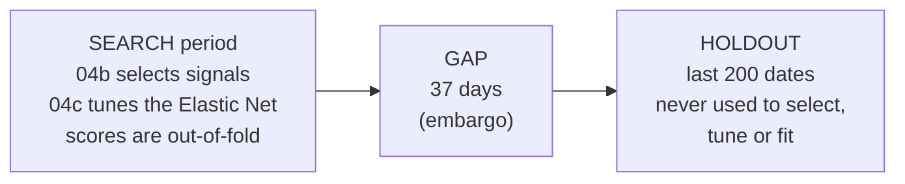

| Period | What the score is | Can I quote a result from it? |
|---|---|---|
| Search | Out-of-fold. The model that scored a row never trained on it. | Only as a development number. Alpha and l1_ratio were picked on these folds. |
| Gap | Final model. Too close to the search period (labels overlap). | No. |
| **Holdout** | Final model, on dates it never saw. | **Yes. This is the number.** |

04f prints the holdout block. No parameter is changed because of what the holdout shows.

---

## 5. Quick start

```bash
git clone https://github.com/qlemoal/quant_alpha_lab.git
cd quant_alpha_lab
python -m venv .venv && source .venv/bin/activate
pip install -r requirements.txt

python scripts/pipeline/01_download_data.py      # Wikipedia + Yahoo, one CSV per ticker (needs network)
python scripts/pipeline/02_etl_prices.py         # ohlcv.parquet
python scripts/pipeline/03_build_features.py     # features.parquet

# Stages 04a to 04f in one command (stops at the first failure):
python scripts/pipeline/04_run_all.py --date 2026-11-07 --tag default

# Part of the chain:
python scripts/pipeline/04_run_all.py --date 2026-11-07 --tag default --from 04d
python scripts/pipeline/04_run_all.py --date 2026-11-07 --tag default --only 04f

pytest -q                                        # unit and regression tests, a few seconds
```

### Benchmark with cheating signals

To check what the pipeline does with a signal of a **known** strength, add signals built from the future return plus noise:

```bash
python scripts/pipeline/04_run_all.py --date 2026-11-07 --tag cheat --cheat
```

- Edit `CHEAT_SIGNALS` in `04a_generate_signals.py`: one line `(horizon, rank IC)`, for example `(20, 0.05)`. Typical real signal: 0.02. Very strong: 0.30.
- The tag **must** contain `cheat`, so that a cheat run never replaces a real run.
- A cheat run is a sanity check of the chain (selection, combiner, costs). It is **not** a strategy: it uses the future.
- Each cheat signal has its own independent noise (`src/signals/cheat.py`, tested). With a shared noise a linear model could cancel it and rebuild the future return.

Read the **HOLDOUT** block printed by 04f. It gives the net Sharpe, its 95% interval, the annual return, the drawdown, the market beta and the Sharpe at higher costs.

---

## 6. Stage by stage

Each stage has a diagram (what happens), a **why**, and a **guard** (what stops a silent error).
The formulas and the reasoning are in [docs/methodology.md](docs/methodology.md).

### 01 · Download

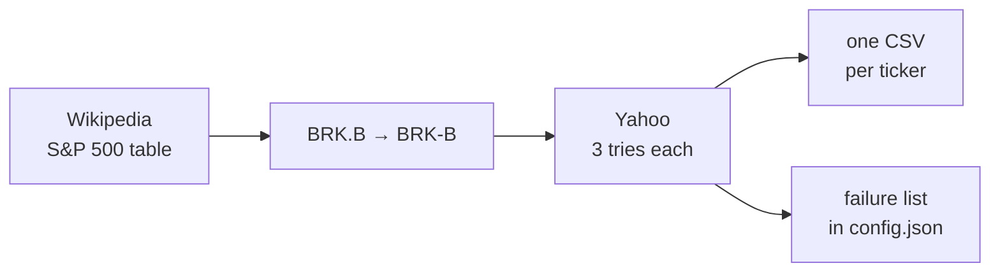
- **Why:** Yahoo wants a dash in the share class. Without the fix, BRK.B and BF.B are silently missing.
- **Guard:** the script stops if more than 5% of the tickers fail. A network problem never gives a silent half-universe.

### 02 · ETL

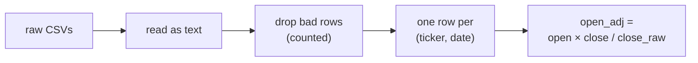
- **Why `open_adj`:** we trade at the open. The open must be on the same adjusted scale as the close. If not, open-to-open returns jump at each dividend.
- **Guard:** each removed row is counted by reason (unreadable, price or volume ≤ 0, duplicate). Nothing is dropped in silence.

### 03 · Features

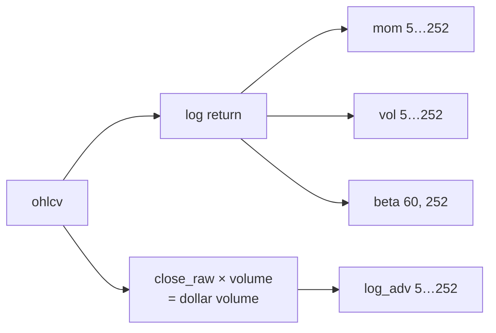
- **Why `close_raw`:** dollars traded = price as traded × shares traded. The adjusted close understates old dollar volume.
- **Guard:** no-look-ahead test. The script stops on duplicate rows, bad prices, NaN or inf.

### 04a · Signals

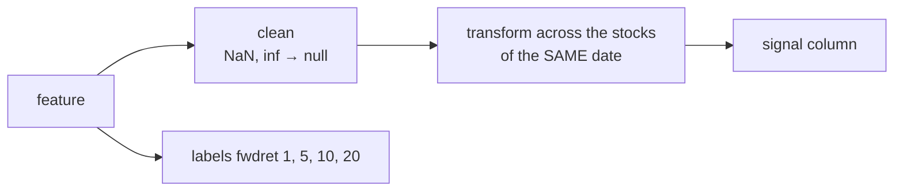
- **Transforms:** `zscore_tanh`, `zscore_clip`, `rank`, `decile`.
- **Why cross-sectional:** the strategy bets on the order of stocks on one date, not on the market level.
- **Guard:** 04a never measures return prediction (no IC, no Sharpe). The holdout cannot influence which signals you build. A check proves that no label crosses from one ticker to the next.

### 04b · Evaluate

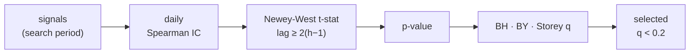
- **Why a long Newey-West lag:** labels of consecutive days overlap by h − 1 days. The IC series is autocorrelated by construction.
- **Guard:** a non-overlapping t-statistic (one IC every h days) is the cross-check. Selection uses the search period only.

### 04c · Combine

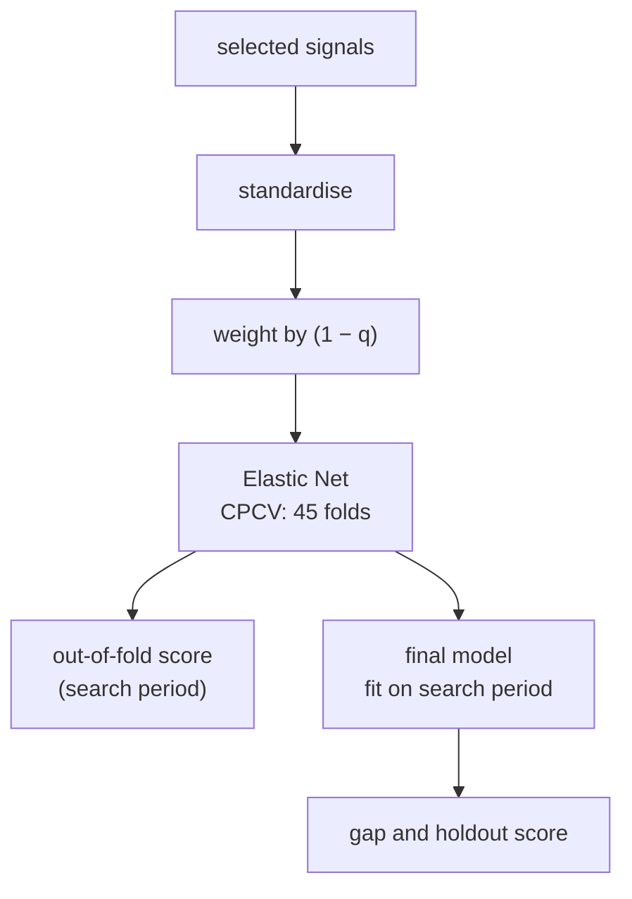
- **Why out-of-fold:** a model that scores the data it trained on gives a score that looks too good.
- **Guard:** the holdout labels can be destroyed without changing the model (test).

### 04d · Risk model

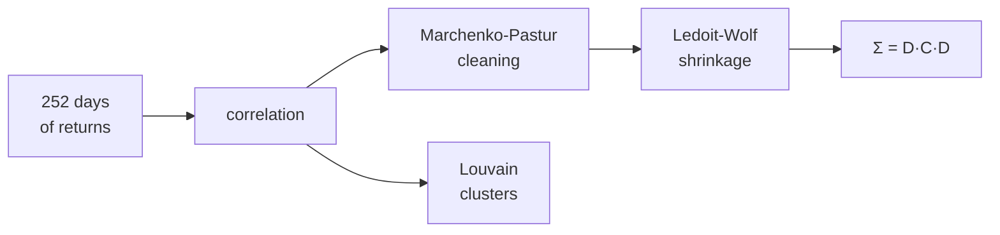
- **Why:** 500 stocks over 252 days give a noisy correlation matrix. Cleaning keeps the market and sector factors and removes noise.
- **Guard:** the diagonal of Σ equals the stock variances (test). Shrinkage is checked on a simulation with a known truth.

### 04e · Weights

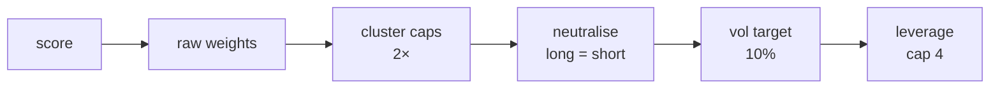
- **Units:** weights are fractions of capital. gross = Σ|w|. gross 1 = 50% long + 50% short.
- **Guard:** the stage stops if the book is not dollar-neutral, not finite, or above the leverage cap.

### 04f · Backtest

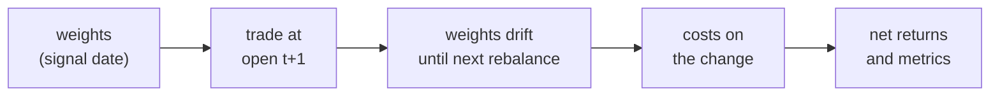
- **Costs:** half-spread + square-root market impact + commission.
- **Guard:** the Sharpe uses √(252/h) for h-day returns. The drawdown uses a compounded curve. Both were wrong in an earlier version.

---

## 7. How the data is stored

```
data/
├── raw/yfinance/equities/US/SP500/daily/ohlcv/*.csv      immutable, as downloaded
└── clean/equities/US/SP500/daily/
    ├── ohlcv/         ohlcv.parquet            one file, shared by all runs
    ├── features/      features.parquet         one file, shared by all runs
    ├── signals/       {run_id}/                signals.parquet, config.json
    ├── signal_eval/   {run_id}/                ic_summary, ic_decay, fdr_report, selected_signals.json
    ├── en_scores/     {run_id}/                en_scores.parquet
    ├── en_model/      {run_id}/                model.json, stability.parquet
    ├── risk_model/    {run_id}/                cov, corr_clean, clusters, summary.json
    ├── weights/       {run_id}/                weights.parquet, weights_diag.parquet
    └── backtest/      {run_id}/                returns, trades, metrics.json, equity_curve.png
```

- `run_id = {date}_{tag}`, for example `2026-11-07_default`. A new tag keeps the old result.
- Each run saves its provenance: git commit, hash of the input file, hash of the parameters.
- Raw data is never edited. Parquet files are git-ignored. Small JSON summaries can be committed.

---

## 8. Repository map

```
quant_alpha_lab/
├── config/                  paths.py (all paths in one place), constants.py
├── scripts/
│   ├── pipeline/            01 … 04f and 04_run_all.py     thin scripts, heavy comments
│   ├── research/            standalone research scripts
│   └── demos/               inspect_signals.py, GBM vs EN (PBO), coefficient stability
├── src/
│   ├── data/                download.py, prices_etl.py                       stages 01, 02
│   ├── features/            returns, momentum, volatility, adv, beta         stage 03
│   ├── signals/             combine, normalize, ranking, signal_pipeline,    stage 04a
│   │                        cheat (benchmark signals with a known IC)
│   ├── evaluation/signals/  ic/, FDR.py, performance.py, report.py           stage 04b
│   ├── validation/          cpcv.py (+ PBO), walk_forward_cv.py
│   ├── models/              elastic_net_combiner.py (04c), gbm_combiner.py
│   ├── risk/                risk_model, covariance, correlation_cleaning,    stages 04d, 04e
│   │                        clustering, portfolio_construction, weights_pipeline
│   ├── portfolio/           weights_backtest.py (04f), costs.py,
│   │                        backtest.py, optimization.py (library, see below)
│   └── utils/               helpers, panels, stats
├── tests/                   unit tests, regression tests, edge-case fixtures
└── docs/                    methodology.md, findings.md, tips_and_tricks.md
```

**Library modules that are not in the main pipeline** (tested pieces, not wired into 04a to 04f):
`optimization.py` (HRP, ERC, Black-Litterman, cost-aware MVO), `gbm_combiner.py` with the PBO comparison, `walk_forward_cv.py`, and the older engine `backtest.py`.
`04_build_portfolio.py` is a legacy script, kept until it is archived.

---

## 9. Status

| Stage | Code | Tests | Notes |
|---|---|---|---|
| 01 Download | rewritten | fake downloader | needs network to run |
| 02 ETL | rewritten | yes | |
| 03 Features | rewritten | no-look-ahead test | |
| 04a Signals | rewritten | label alignment | |
| 04b Evaluate | rewritten | FDR, Newey-West | selection on the search period only |
| 04c Combine | rewritten | holdout untouched | |
| 04d Risk model | rewritten | covariance, shrinkage | |
| 04e Weights | rewritten | partial | checks at every date |
| 04f Backtest | rewritten | partial | costs are assumptions (section 10) |
| PBO, walk-forward, HRP, ERC, BL, MVO | library | partial | not wired into the pipeline |

All stages were run end to end on synthetic data with a known truth. **They have not yet been run on the real data after the fixes.**
Earlier outputs came from code with the label bug (section 11) and are not valid. Rerun 02 → 04f.

---

## 10. Known limitations

These are written down on purpose.

1. **Survivorship bias.** The universe is today's S&P 500 members, applied to the past. Companies that left the index are missing. Backtests look better than reality, mostly before 2015. A point-in-time list needs CRSP or Compustat.
2. **Data source.** Yahoo Finance is free and unofficial. `Adj Close` is restated at each corporate action, so a new download can differ slightly.
3. **Costs are assumptions.** AUM 100 million dollars, half-spread 3 bps, impact coefficient 0.5, commission 1 bp, leverage cap 4. The backtest prints the Sharpe at 1×, 1.5×, 2× and 3× costs. Borrow cost, financing cost and delisting returns are **not** modelled. They make the result optimistic.
4. **One holdout path.** The holdout is 200 dates of one history. The Sharpe interval is wide, and the output shows it.
5. **Correlated candidates.** Transforms of one feature are not independent tests. BH can be too permissive. BY and the non-overlapping t-statistic are the cross-checks.
6. **Beta proxy.** The market is the equal-weighted mean of the stocks in the file, not the index.
7. **Scope.** US equities, daily bars. No intraday data, no other asset class, no fundamentals.

---

## 11. Bugs found by review, and the test that guards each

| # | Where | What was wrong | Effect | Guard |
|---|---|---|---|---|
| 1 | `features/returns.py` | The label shift ran over the whole table, not per ticker. | The end of each ticker held the prices of the next ticker, including the last dates (holdout). | regression test + `check_labels` in 04a |
| 2 | `performance.py` | Sharpe of overlapping h-day returns annualised with √252. | Sharpe too large by about √h. | `test_performance` |
| 3 | `performance.py` | Drawdown on a cumulated sum of overlapping returns. | Drawdown wrong by a large factor. | `test_performance` |
| 4 | `ic/metrics.py` | Newey-West lag too short for the label overlap. | Too many false positives. | simulation, `test_newey_west` |
| 5 | 04b | Selection used all dates, holdout included. | Holdout leaked into the choice of signals. | search-period rule shared with 04c |
| 6 | 04c | One static model scored the whole history. | In-sample scores looked too good. | out-of-fold scores, `test_en_combiner` |
| 7 | `risk_model.py` | The shrunk correlation was returned as covariance. | Volatility target wrong by a large factor. | `test_risk_model` (diagonal = variance) |
| 8 | `covariance.py` | Ledoit-Wolf intensity lacked the division by N. | Matrix collapsed to the identity: error 848 against 56 for the sample matrix. | `test_covariance` |
| 9 | `covariance.py` | The OAS formula was wrong. | Intensity near 0. | test against sklearn |
| 10 | `liquidity.py` | Dollar volume used the adjusted close. | Old liquidity too small for dividend payers. | `test_dollar_volume_uses_the_raw_close` |
| 11 | `02_etl_prices.py` | `SELECT DISTINCT` kept duplicates that differed in one value. | Two rows for one (ticker, date). | `test_prices_etl` |
| 12 | `01_download_data.py` | Tickers with a dot were not converted. | BRK.B and BF.B silently missing. | `test_to_yahoo_symbol` |
| 13 | `04_run_all.py` | It crashed at import and after a good run. | No one-command pipeline. | run from another directory |
| 14 | 04c | NaN labels passed the null filter. | Holdout IC was NaN. | `is_not_nan` filters, test |

---

## 12. Design principles

- **No look-ahead.** Signal at the close of t, trade at the open of t+1, label from the same open.
- **Few free parameters.**
  - Rank IC over raw backtest Sharpe: harder to overfit.
  - Newey-West lag from the label overlap: not tuned per signal.
  - Storey q-value over a fixed α: π₀ is estimated from the data.
  - Louvain over k-means: there is no *k* to choose.
- **The holdout is not used to select, tune or fit.**
- **Thin scripts, tested libraries.**
- **Fail loudly.** A check stops the run on a broken book or a broken label. It never saves garbage.
- **Every number has a unit.** Weights are fractions of capital. Volatilities are annualised. The code says so.

> **On the use of language models.** `correlation_cleaning.py` was written by hand on purpose, to understand every decision.
> Models are then used for code generation, discussion, debugging and review.
> Every design decision is mine. Every suggestion is read, questioned and checked against a second implementation or a simulation with a known truth.

---

## 13. Testing

`pytest -q` runs the whole suite in a few seconds.

- **Regression tests** for every bug in section 11.
- **Simulations with a known truth:** a planted signal that the Elastic Net must recover, a known correlation matrix that shrinkage must improve, a market with a known beta.
- **The "Musée des Horreurs":** edge-case fixtures in `tests/conftest.py`, used by the signal and FDR tests.

| Fixture | What it catches |
|---|---|
| `panel_unsorted` | a missing `.sort()` |
| `panel_ragged` | IPOs and delistings: tickers not on every date |
| `panel_single_ticker` | group of size 1: std = 0, degenerate rank |
| `panel_identical_values` | all equal: std = 0, all ranks tied |
| `panel_with_nulls` | missing features |
| `panel_uneven_group` | 7 tickers do not divide into 10 deciles |
| `panel_with_ties` | tied values in quantile buckets |

---

## 14. Roadmap

- [ ] Run 02 → 04f on the real data and fill in a results section
- [ ] Point-in-time constituents (a free approximation, then CRSP if available)
- [ ] Index as market proxy for beta
- [ ] Borrow and financing costs in the backtest
- [ ] Factor attribution (style, sector)
- [ ] Wire PBO and walk-forward into the pipeline
- [ ] Fundamentals, seasonality, intraday
- [ ] Regime-aware construction

---

## 15. References

| Area | Reference |
|---|---|
| FDR | Benjamini & Hochberg (1995) · Benjamini & Yekutieli (2001) · Storey (2002), Storey & Tibshirani (2003) |
| Autocorrelation | Newey & West (1987, 1994) |
| Purged CV, CPCV | López de Prado (2018), *Advances in Financial Machine Learning*, ch. 7 and 12 |
| Backtest overfitting | Bailey, Borwein, López de Prado & Zhu (2017), *J. Computational Finance* 20(4) |
| Random matrix theory | Marchenko & Pastur (1967) · Laloux, Cizeau, Bouchaud & Potters (1999), *PRL* 83(7) |
| Shrinkage | Ledoit & Wolf (2003, 2004) · Chen, Wiesel, Eldar & Hero (2010), *IEEE TSP* 58(10) (OAS) |
| Number of factors | Bai & Ng (2002), *Econometrica* 70(1) |
| Clustering | Blondel, Guillaume, Lambiotte & Lefebvre (2008), *J. Stat. Mech.* (Louvain) |
| Risk parity | López de Prado (2016), *J. Portfolio Management* 42(4) (HRP) |
| Trading costs | Almgren & Chriss (2000), *J. Risk* 3(2) · Gârleanu & Pedersen (2013), *J. Finance* 68(6) |
| Sharpe uncertainty | Lo (2002), *Financial Analysts Journal* 58(4) |
| Multiple testing in finance | Harvey, Liu & Zhu (2016), *Review of Financial Studies* 29(1) |

---

## License

MIT. See `LICENSE`.