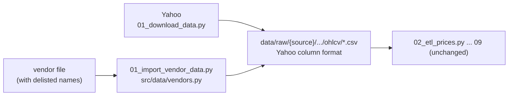

# Data sources and universes

## Why not only Yahoo

Yahoo Finance gives prices of companies that exist today. Companies that were delisted (bankrupt, bought, dropped from the index) are missing. A backtest on survivors looks better than the real history. This is survivorship bias (see methodology, section 14).

## Options (prices and conditions change: check each vendor)

| Source | Covers | Delisted names | Note |
|---|---|---|---|
| Yahoo (now) | current names | no | free, survivorship bias |
| Sharadar SEP (Nasdaq Data Link) | US all-cap | yes | the cheapest way to fix survivorship. Preset `sharadar` exists, untested on a real file |
| Norgate | US, global | yes | adjusted-price conventions differ: write a mapping and check |
| CRSP via WRDS | US | yes | the academic standard, if EPFL has access |

## Universes worth testing for alpha

| Universe | Why | Cost of trading |
|---|---|---|
| US all-cap with a liquidity filter | most breadth, less efficient small caps | rises as size falls |
| Russell 3000 without the largest names | the S&P 500 is the most efficient part of the market | medium |
| STOXX 600 | other market, close to a Swiss job | medium |
| Swiss SPI | local | few stocks, high cost |
| Global developed | breadth and low correlation between markets | currency and borrow issues |

Rule of thumb: more alpha usually comes with more cost and less capacity. A liquidity filter (for example price above 5 and a minimum average dollar volume) is required on all-cap, otherwise micro-caps dominate. This filter is not written yet.

Before using a new source, check by hand one stock with a split and one with a high dividend: `Close` must be split-adjusted only, `Adj Close` split and dividend adjusted.