# Methodology

This document explains each stage of the pipeline: **what** it does, **why**, the **formulas**, the **checks**, and the **limits**.
The README gives the overview. This file gives the reasoning.
Math is written in plain text (no LaTeX), so it reads the same everywhere.

**Contents**
1. [Conventions](#1-conventions)
2. [Data layer (01, 02)](#2-data-layer-stages-01-and-02)
3. [Features (03)](#3-features-stage-03)
4. [Signals (04)](#4-signals-stage-04)
5. [Signal evaluation (05)](#5-signal-evaluation-stage-05)
6. [False discovery rate](#6-false-discovery-rate)
7. [Validation: CPCV, purge, embargo, holdout](#7-validation)
8. [Combination: Elastic Net (06)](#8-combination-stage-06)
9. [Risk model (07)](#9-risk-model-stage-07)
10. [Portfolio construction (08)](#10-portfolio-construction-stage-08)
11. [Backtest (09)](#11-backtest-stage-09)
12. [Metrics: definitions](#12-metrics-definitions)
13. [Library modules not in the pipeline](#13-library-modules-not-in-the-pipeline)
14. [Limitations](#14-limitations)
15. [Reproducibility](#15-reproducibility)
16. [References](#16-references)

---

## 1. Conventions

### 1.1 The clock

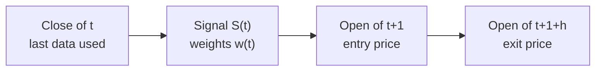

- Signal at the close of day t. Trade at the open of day t+1. This is the earliest trade that is possible.
- Label (forward return): `fwdret_h(t) = log(open_adj[t+1+h]) − log(open_adj[t+1])`.
- Default h = 20 trading days. Horizons 1, 5, 10 and 20 are saved.
- A label of day t and a label of day t+1 share h − 1 days. They overlap. Every test below accounts for this.

### 1.2 Units

| Quantity | Unit |
|---|---|
| Weight | fraction of NAV. Gross = Σ|w|. Gross 1 means 50% long and 50% short. |
| Volatility, covariance | annualised (daily × 252) |
| Costs | basis points of traded dollars, then returned as fractions of NAV |
| Sharpe | annualised. For h-day returns: mean / std × √(252 / h) |

### 1.3 Periods


- **Holdout:** the last 200 dates that have a label.
- **Gap:** `embargo` dates between the end of the search period and the start of the holdout, so no search label reaches into the holdout.
- 05 and 06 use the search period only. 09 reports the holdout separately.

---

## 2. Data layer (stages 01 and 02)


### 2.1 Download (01)

- Universe: the current S&P 500 members from Wikipedia. Yahoo uses `-` where Wikipedia uses `.` for share classes.
- Each ticker gets 3 tries. A download is accepted only if it has the expected columns and at least 20 rows.
- Failures are saved in `config.json`. The script stops if more than 5% of tickers fail.
- `auto_adjust = False`. We keep both the price as traded (`close_raw`) and the adjusted close (`close`).

### 2.2 ETL (02)

| Step | Why |
|---|---|
| Read every column as text, then cast | A bad value becomes null and is counted. It does not crash the read. |
| Drop rows with unreadable date, price or volume ≤ 0 | These are data errors. The count per reason is saved. |
| One row per (ticker, date) | Duplicates that differ in one value are removed by a fixed rule, not by chance. |
| `open_adj = open × close / close_raw` | The open must be on the same adjusted scale as the close. |

**Why `open_adj` matters.** We enter and exit at the open. If the open were not adjusted, the open-to-open return would show a fake drop at each ex-dividend date and at each split.

### 2.3 Known data limits

- **Survivorship bias:** only today's members are in the universe (section 14).
- Yahoo restates the adjusted close at each corporate action. A new download can differ in the last digits.

---

## 3. Features (stage 03)

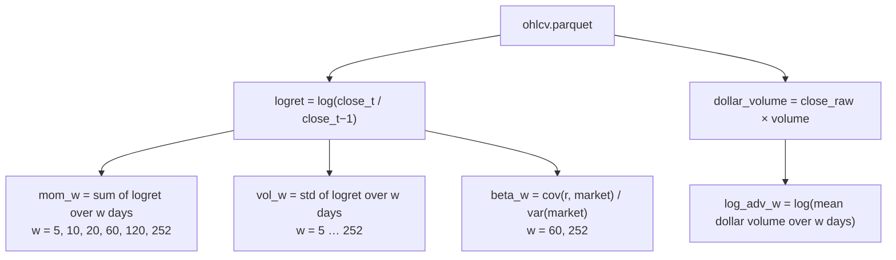

- **Momentum** `mom_w`: cumulative log return over the last w days.
- **Volatility** `vol_w`: standard deviation of daily log returns over the last w days.
- **Liquidity** `log_adv_w`: log of the average dollar volume. It uses `close_raw`, because dollars traded = price as traded × shares.
- **Beta** `beta_w`: regression slope on the equal-weighted market return (a proxy; section 14).

**Why windows from 5 to 252:** short windows capture reversal, long windows capture trend. The data decides which is useful (stage 05). The number of candidates is counted in the false discovery rate.

**Check:** all features are computed per ticker with trailing windows. A test cuts the prices at a date and confirms that no earlier feature changes (no look-ahead).

---

## 4. Signals (stage 04)

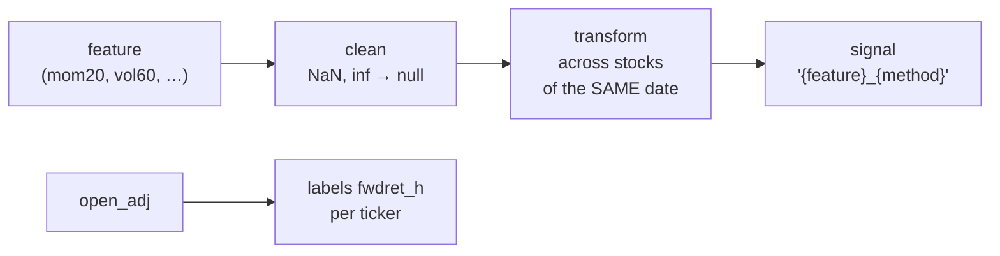

### 4.1 Transforms

| Method | Formula (per date, across stocks) | Use |
|---|---|---|
| `zscore` | z = (x − mean) / std | scale-free comparison |
| `zscore_tanh` | tanh(z / scale) | bounded in (−1, 1), outliers pushed in |
| `zscore_clip` | clip(z, −3, 3) | bounded, linear inside |
| `rank` | 2 × (rank − 1) / (N − 1) − 1 | uniform in [−1, 1] |
| `decile` | +1 top 10%, −1 bottom 10%, 0 otherwise | sparse long-short |

**Why across stocks of the same date:** the strategy bets on which stock is better *today*, not on whether the market is high. A cross-sectional transform removes the market level and the time trend from the signal.

**Why `clean_features` first:** a null is skipped by the mean of a date. A NaN is not. One NaN would turn the mean of the whole date into NaN.

### 4.2 Labels

- `fwdret_h` is computed **per ticker**. The last h + 1 rows of each ticker have no label (the prices do not exist).
- **Check `check_labels`:** if any of those rows has a value, the label crossed a ticker boundary and the script stops. This guards bug 1 of the README table.
- **Check `calendar_gaps`:** labels shift by rows. A row shift equals trading days only if the ticker has a row for every date. The script reports the missing share.

### 4.3 What 04 never does

It never computes a return-based statistic of a signal. Looking at IC over all dates here would let the holdout influence which signals you decide to build. The descriptive statistics (null share, mean, std, names per date) use no returns.


### 4.4 Benchmark signals: cheat and placebo (options of stage 04)

Two kinds of signal have a **known** true strength. They test the pipeline, not the market.

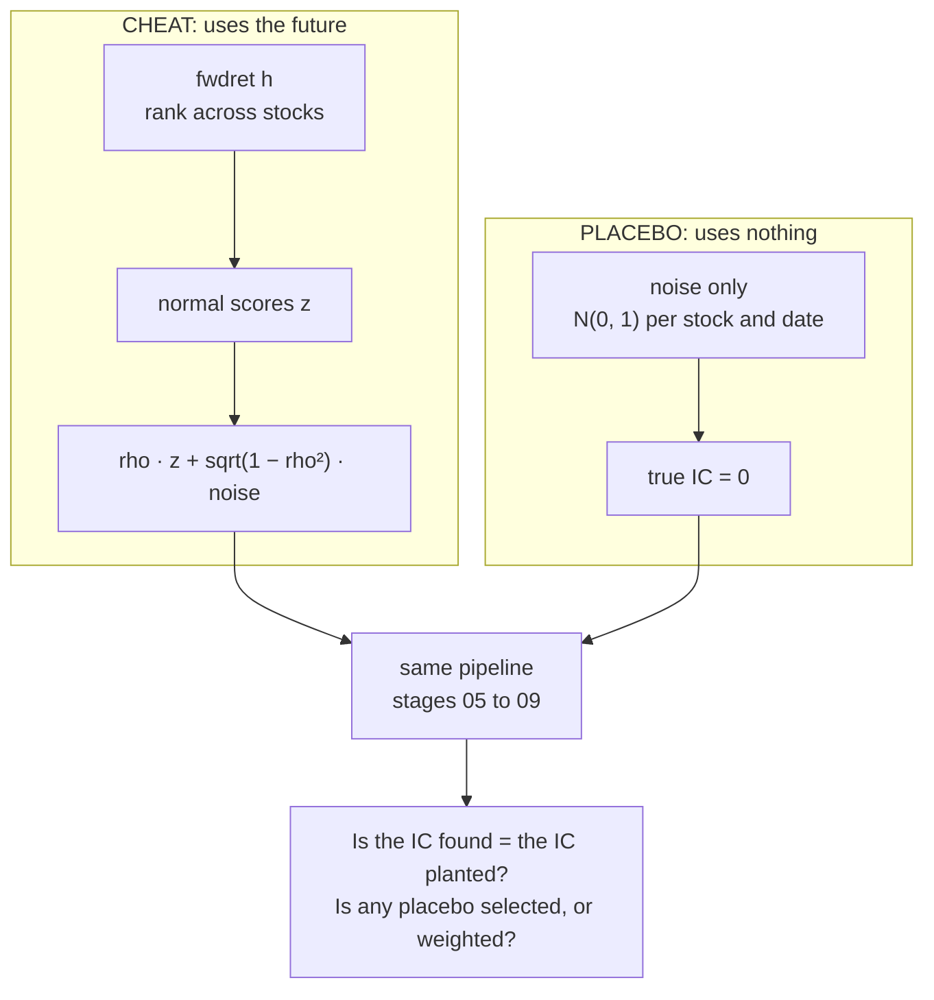

- **Cheat:** `signal = rho × z + sqrt(1 − rho²) × noise`, with `rho = 2 sin(pi × IC / 6)`, so that the **rank** correlation with the forward return is the wanted IC. IC 1 is refused: the IC would be the same every day, and its t-statistic would not exist.
- **Placebo:** pure noise, no return used. Its true IC is 0. Over many placebos, about 5% should have p < 0.05, and after the FDR step almost none should be selected.
- **Independent noise for each signal.** With one shared noise, a linear model subtracts one cheat from another, removes the noise and finds the future return exactly (IC = 1). A test guards this.
- **Persistent noise** (`noise_days = k`): the noise is the average of the last k daily draws. A real signal changes slowly, so its IC series is autocorrelated and its turnover is moderate. A noise that is new every day gives a huge t-statistic (almost independent daily ICs) and a huge turnover. Placebos mix fast and slow noise (1, 5, 20 and 60 days): slow junk is the case where a wrong Newey-West lag gives false discoveries.
- **Tags:** a run with cheat signals needs `cheat` in its tag, a run with placebos needs `placebo`.

**What stages 05 and 06 print for them**

| Stage | Output |
|---|---|
| 05 | Placebos selected, and placebos with raw p < 0.05 against the 5% expected by chance. The real signals' selection **inside the full family** against **alone**. |
| 06 | Share of the score variance by signal and by group (real, cheat, placebo). A warning if placebos carry more than 1%. |

**Dilution.** The FDR step controls the *share* of false signals among the selected ones. If sure signals are in the family, the same share allows more weak signals to pass: the threshold of rank k is `k × alpha / m`, and k includes the sure signals. The opposite also happens: many useless tests (placebos) make `m` larger and every threshold stricter. The report shows both effects.

---

## 5. Signal evaluation (stage 05)

> The selection rule (six gates: prior, sign, Newey-West t >= 3, non-overlapping t >= 2, q < 0.05, deflated Sharpe >= 0.95) and the family combination of stage 06 are described in [selection.md](selection.md).

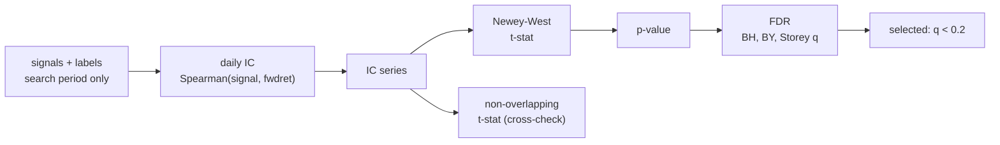

### 5.1 Information coefficient

For each date d: `IC(d) = Spearman rank correlation between signal(d, i) and fwdret_h(d, i), over stocks i`.

**Why Spearman (rank):** it ignores outliers and the scale of returns. It measures only the *order* of stocks, which is what a long-short portfolio uses.

**Why IC and not Sharpe:** the IC has fewer free choices (no weights, no costs, no leverage). It is harder to overfit.

### 5.2 Newey-West t-statistic

The IC series has autocorrelation by construction: IC(d) and IC(d+1) use labels that share h − 1 days.
A plain t-statistic `mean(IC) / (std(IC) / √n)` would be too large.

- Newey-West uses a long-run variance with Bartlett weights over `L` lags.
- `L = max(1, 4 × (n / 100)^(2/9), 2 × (h − 1))`. The term 2(h − 1) comes from the overlap. The first term is the standard rule.
- `t = mean(IC) / sqrt(LRV / n)`, p-value from the normal law (two-sided).

**Cross-check:** keep one IC every h days (no overlap) and compute a plain t-statistic. The two should agree in sign and order of size. A signal that passes only the Newey-West test is suspicious.

### 5.3 Outputs

`ic_summary` (mean IC, t-stat, p-value, hit rate), `ic_decay` (IC at each horizon), `fdr_report` (BH, BY, Storey q), `selected_signals.json` (names, q-values, search period, horizon).

---

## 6. False discovery rate

We test many signals. At a 5% level, 1 in 20 pure-noise signals passes. The false discovery rate (FDR) controls the *share of false signals among those we select*.

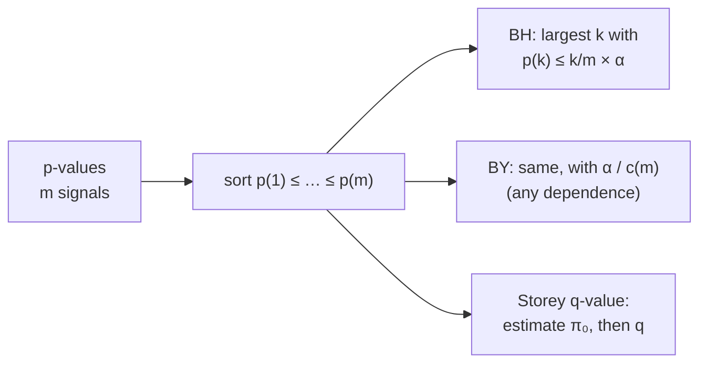

| Method | Rule | When |
|---|---|---|
| BH (Benjamini-Hochberg) | reject p(1..k), k the largest with p(k) ≤ (k / m) × α | independent or positively dependent tests |
| BY (Benjamini-Yekutieli) | BH with α divided by c(m) = Σ 1/j | any dependence. More strict. |
| Storey q-value | q(i) = π₀ × m × p(i) / i, made monotone. π₀ = share of true nulls, estimated from large p-values. | the selection rule used here: q < α (default 0.2) |

**Selection weights.** 06 uses `(1 − q)` as a prior weight for each selected signal. A weaker signal enters with a smaller weight.

**Honest warning.** Transforms of one feature (mom20 with tanh and with rank) are not independent tests. BH can then be too permissive. The BY column and the non-overlapping t-statistic are there for this reason.

---

## 7. Validation

### 7.1 Why plain K-fold fails here

Labels overlap in time. A training row at day t and a test row at day t + 5 share 15 days of return. A random split leaks the answer.

### 7.2 Combinatorial Purged CV (CPCV)

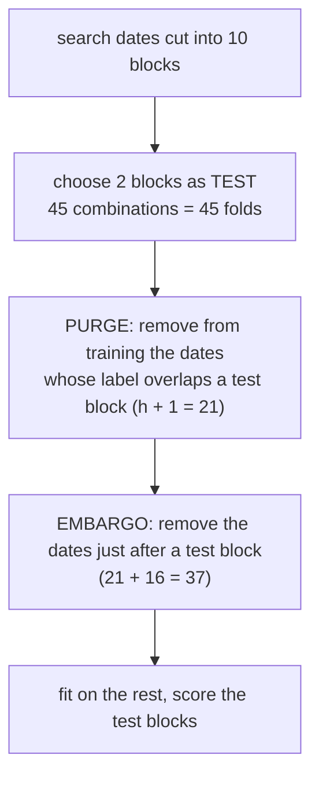

```
 blocks:   1   2   3   4   5   6   7   8   9  10
 fold k:   .   T   .   .   .   T   .   .   .   .       T = test, . = train
                  ^^^                  ^^^
                  purge before, embargo after each test block
```

- Each date is in the test set of 9 of the 45 folds. Its out-of-fold score is the **average** of its 9 test predictions.
- Purge = h + 1 = 21 dates. Embargo = purge + 16 = 37 dates (16 = `EMBARGO_WINDOW`, the length of the longest feature memory that matters after a block).
- **Holdout:** the last 200 labelled dates. Not in the 10 blocks. A gap of `embargo` dates separates the search period from it.

### 7.3 What the out-of-fold score means

A score for date d comes from models that never saw d (nor its overlapping neighbours). It is an honest estimate of how the model behaves on new dates **for fixed hyperparameters**. The hyperparameters themselves (alpha, l1_ratio) are chosen on the same folds, so search-period scores are still optimistic. Only the holdout is clean.

---

## 8. Combination (stage 06)

> Default mode after a strict 05: sign-aligned family scores, non-negative Elastic Net, one-standard-error rule, drop-one test. See [selection.md](selection.md). The text below describes the per-signal mode (`--combine signal`).

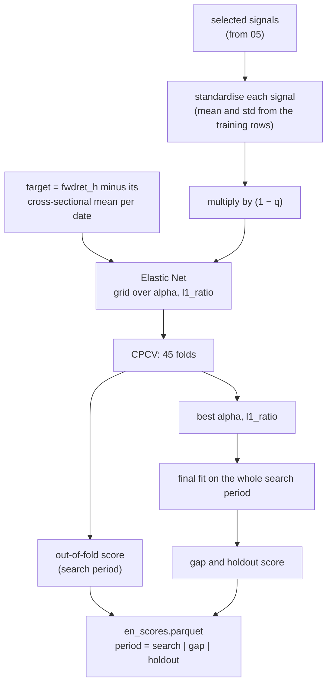

### 8.1 Model

`score(i, d) = Σ_k beta_k × x_k(i, d)`, where x_k is the standardised signal k, multiplied by (1 − q_k).
Elastic Net minimises: `mean squared error + alpha × (l1_ratio × Σ|beta| + (1 − l1_ratio) / 2 × Σ beta²)`.

**Why Elastic Net:**
- L1 removes signals that add nothing.
- L2 shares weight among correlated signals (many signals are transforms of the same feature). Pure Lasso would pick one at random.
- The model is linear. Every coefficient can be read and plotted (`en_combiner_coef_stability.png`).

**Why a demeaned target:** the portfolio is dollar-neutral. The market return of the day is not what we predict. We predict the order of stocks.

### 8.2 Output layout

| `period` | Meaning |
|---|---|
| `search` | out-of-fold score (average of the folds where the date was test) |
| `gap` | final model on dates between search and holdout |
| `holdout` | final model on the last 200 labelled dates |

### 8.3 Checks (tests)

- A planted signal in a synthetic panel is recovered (coefficient has the right sign and size).
- Every search date has an out-of-fold score.
- Purge and embargo dates are respected.
- If the holdout labels are destroyed, the model does not change.
- The holdout IC on the planted signal is positive.

---

## 9. Risk model (stage 07)

**Goal:** an estimate of the covariance Σ of the stock returns, good enough to size the book and to cap clusters.

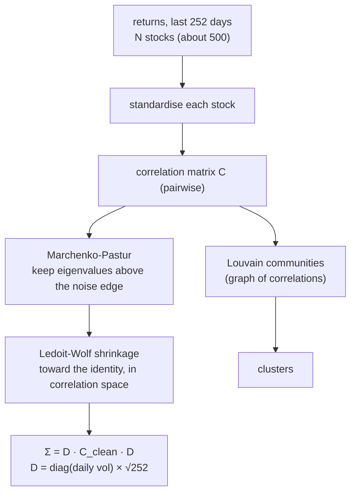

### 9.1 The problem

With N = 500 stocks and T = 252 days, T / N ≈ 0.5. The sample covariance has rank at most T − 1. Its small eigenvalues are close to 0 and its large ones are too large. An optimiser would use this noise.

### 9.2 Marchenko-Pastur cleaning

For pure noise with ratio q = N / T, the eigenvalues of the correlation matrix fall in `[(1 − √q)², (1 + √q)²]`.

- Eigenvalues above the upper edge carry structure (market, sectors). They are kept.
- Eigenvalues inside are noise. They are replaced by their average (the trace is kept).
- Result: a cleaned correlation matrix with a clear factor part.

### 9.3 Ledoit-Wolf shrinkage

`C_final = (1 − rho) × C_clean + rho × I`. The intensity `rho` is estimated from the data (no free parameter) in correlation space, from the standardised returns.
Check: a simulation with a known covariance (error against the truth: shrunk ≈ 45–55, sample 56, a broken version 848).

### 9.4 From correlation to covariance

`Σ = D × C × D` with `D = diag(daily vol) × √252`. The diagonal of Σ equals the annualised stock variances. **A test checks this** (bug 7 returned C as if it were Σ).

### 9.5 Louvain clusters (what they are and why)

**Why clusters.** 500 stocks are not 500 independent bets. Banks move together, oil stocks move together, chip stocks move together. If the portfolio puts most of its risk in one such group, it makes a sector bet, not a stock-picking bet. We have no sector table, so we find the groups from the data.

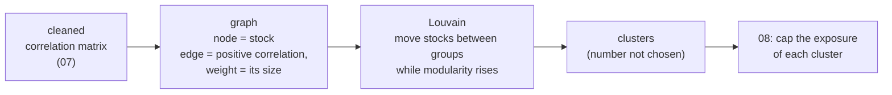

1. **Graph.** Every stock is a node. Two stocks are linked if their correlation is positive. The link weight is the correlation. Negative correlations are dropped: two stocks with correlation −0.8 hedge each other, so they must not be grouped.
2. **Modularity.** For a partition, modularity is the share of link weight inside groups minus the share expected in a random graph where every node keeps its total link weight. High modularity means groups are much denser inside than chance.
3. **Louvain.** Each stock starts alone. It moves to the neighbouring group that raises modularity most. Then each group becomes one node and the process repeats. It stops when no move helps. The number of groups is a result, not an input.
4. **Resolution.** A value above 1 gives more and smaller groups. The default is 1.
5. **Cap in 08.** No cluster may take more than 2 × gross / K of the gross exposure, where K is the number of clusters.

**Known weakness: the market mode.** All stocks share a market-wide factor, so almost every pair is positively correlated. The graph is then one dense blob and Louvain finds only about 3 large groups. Caps on 3 groups protect little. The fix is to remove the market mode before clustering (section 9.5b).

### 9.5b Removing the market mode before clustering (design, not yet in the code)

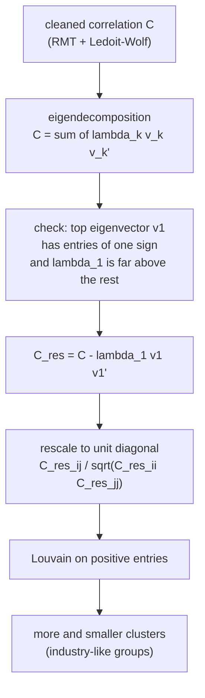

The top eigenvector of a stock correlation matrix is the market: all entries have the same sign and its eigenvalue is much larger than the others. Subtracting its part leaves the correlation between stocks that is not explained by the market. Industry groups then stand out. Checks to run: the sign check of v1, the number of clusters (expect roughly 8 to 15), and the stability of the groups across dates. A second option is to regress each stock on the equal-weighted market return and correlate the residuals. It is easier to explain but needs the return history, not only the matrix.

---

### 9.6 Dates

The model is estimated on **weekly rebalance dates**, each with the trailing 252 days. Nothing after the date is used.

---

## 10. Portfolio construction (stage 08)

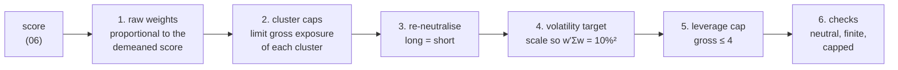

| Step | What | Why |
|---|---|---|
| 1 | `w_i ∝ score_i − mean(score)` on the stocks that have a score and a risk estimate, then Σ|w| = 1 | simple and transparent. Score size = conviction. |
| 2 | Cap the gross exposure of each Louvain cluster at 2 × (gross / number of clusters). Overweight clusters are scaled down. The freed capacity is not redistributed. | a book concentrated in one correlated group is a sector bet, not a stock-picking bet |
| 3 | Subtract the mean again so Σ long = Σ short | capping breaks neutrality |
| 4 | `scale = target_vol / sqrt(w' Σ w)` | the book takes the same risk in calm and in stormy markets |
| 5 | If gross > 4, scale down | an assumption (limits borrowing). It rarely binds with a 10% target. |
| 6 | Checks at each date | the stage stops on a book that is not neutral or not finite |

**Weights are fractions of NAV.** Gross 1 = 50% long, 50% short. After step 4, the gross can be above or below 1.

### 10.1 Leverage explained from scratch

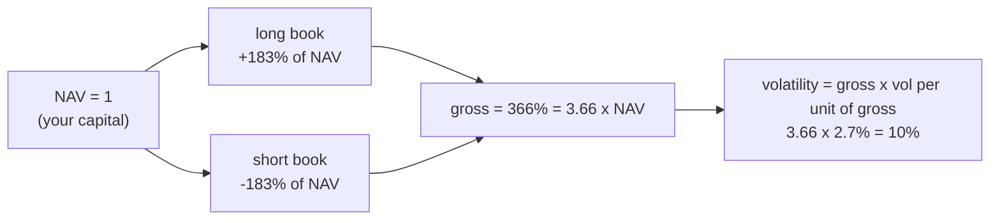

- **NAV** is the capital. A weight of 0.2% means 0.2 of money per 100 of capital.
- **Gross** is the sum of |weights|. A book with 250 longs and 250 shorts at 0.2% each has gross 1.0: 0.5 long and 0.5 short.
- **Why the gross is above 1.** A long-short book is diversified: the random moves of 500 names partly cancel, and the market move cancels between long and short. The volatility per unit of gross is therefore small, about 2.2% in the equal-weight example and about 2.7% in the real book of that date (10% / 3.66). To reach 10% volatility you must scale the whole book up: gross = 10% / vol per unit of gross.
- **Gross 3.66 means** 183% of NAV long and 183% of NAV short. The extra money comes from borrowing (margin at a prime broker).
- **What it costs.** A 1% move of the whole book is a 3.66% move of NAV, and trading costs are paid on the full gross. A weak signal at high leverage pays costs it cannot earn back. This is why the book is cost-fragile.
- **The cap (gross at most 4).** An assumption on how much you could borrow. It binds when the book is very diversified (low vol per unit of gross).

**Output:** `weights.parquet` (date, ticker, weight) and `weights_diag.parquet` (gross, long, short, ex-ante vol, leverage, number of names, per date).

---

## 11. Backtest (stage 09)

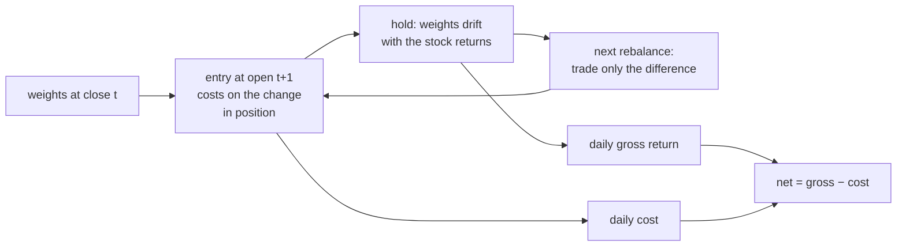

### 11.1 Mechanics

- A weight set from date t is traded at the **open of t+1** (the earliest possible fill).
- Between rebalances the positions are **bought and held**. Weights drift with price moves. We do not rebalance to the target every day (that would hide turnover).
- At each rebalance only the difference between the drifted weights and the new target is traded.

### 11.2 Costs

For each stock traded on a rebalance, with `trade$ = |Δw| × AUM` and `ADV$` its average daily dollar volume:

```
 cost_bps = half_spread + impact + commission
 half_spread = 3 bps                         (fixed, an assumption)
 impact      = kappa × daily_vol × sqrt(participation)    per dollar traded (kappa = 0.5)
               participation = min(1, trade$ / ADV$)
 commission  = 1 bp
 cost        = Σ |Δw| × cost_bps
```

- The square-root law says: impact grows with the *square root* of the trade size relative to the volume.
- AUM matters. A bigger book pays more per dollar.
- The cost is charged on the entry date of the trade.

**Not modelled:** borrow cost of shorts, financing cost, delisting returns, taxes, market-closure effects. These make the result **optimistic**.

### 11.3 Reports

The backtest prints three blocks: whole period, before the holdout, **holdout**. Read the holdout.

| Number | How to read it |
|---|---|
| Sharpe (net) and 95% interval | the interval is wide. A few years cannot pin a Sharpe down. |
| Sharpe gross | the same, without costs. The gap shows the cost drag. |
| Market beta | should be near 0 (dollar-neutral book) |
| Realised vol / ex-ante vol | near 1 means the risk model is right. Far from 1 means it is not. |
| Annual turnover, annual cost (bps) | a signal that trades too much dies by costs |
| Sharpe at 1×, 1.5×, 2×, 3× costs | if the Sharpe falls to 0 at 2×, the strategy is fragile |

---

## 12. Metrics: definitions

| Metric | Definition |
|---|---|
| IC | Spearman correlation of signal and forward return, per date |
| IC t-stat | mean IC / Newey-West standard error |
| Sharpe (daily returns) | mean / std × √252 |
| Sharpe (h-day returns) | mean / std × √(252 / h). **Not** √252: the returns overlap. |
| Sharpe 95% interval (Lo, 2002) | SR ± 1.96 × sqrt((1 + SR² / 2) / n_years-like) with the autocorrelation correction |
| Max drawdown | on the **compounded** curve of non-overlapping returns: min over t of (equity_t / max_{s ≤ t} equity_s − 1) |
| Market beta | slope of the strategy return on the equal-weighted market return |
| Turnover | one-way: Σ |Δw| / 2 per rebalance, summed over a year (multiples of NAV) |
| Realised / ex-ante vol | std of net daily returns × √252 divided by the mean ex-ante vol of 07 |

**Why compounded drawdown:** a cumulated sum of overlapping h-day returns counts each day h times. The drawdown looked about 20 times too large in the first version.

---

## 13. Library modules not in the pipeline

These modules are tested, but 04 to 09 do not call them.

| Module | What it offers | Why not wired yet |
|---|---|---|
| `src/portfolio/optimization.py` | HRP, ERC, Black-Litterman, cost-aware mean-variance | the main pipeline uses the simple proportional chain on purpose, as a baseline |
| `src/models/gbm_combiner.py` + PBO | gradient boosting against Elastic Net, compared by the probability of backtest overfitting | needs a decision on how to report it |
| `src/validation/walk_forward_cv.py` | walk-forward splits | CPCV is the main scheme |
| `src/portfolio/backtest.py` | older backtest engine | replaced by `weights_backtest.py` |
| `scripts/pipeline/04_build_portfolio.py` | legacy script | to be archived |

**PBO (probability of backtest overfitting).** Split the data into blocks. For each combination, pick the best strategy on half the blocks and check its rank on the other half. PBO is the share of cases where the in-sample winner ranks below the median out-of-sample. A value near 0.5 means that selection is not better than chance.

---

## 13b. What to monitor besides the IC

The IC measures only the ranking quality of a signal. A portfolio can have a good IC and still be a poor investment.

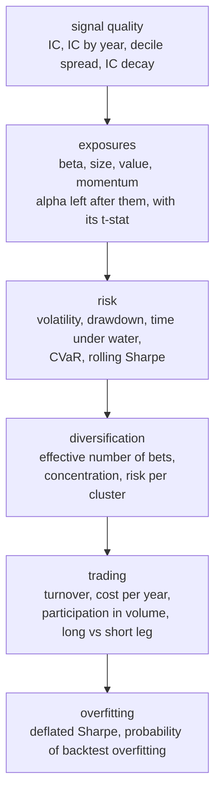

| Group | Metric | In the pipeline today? |
|---|---|---|
| Signal | IC, IC t-stat, IC decay, holdout IC | yes (05, 06) |
| Signal | IC by year, decile spread | no (planned: per-year IC table tests survivorship) |
| Exposures | market beta | measured in 09, not neutralised |
| Exposures | alpha and its t-stat after beta, size, value | no (planned) |
| Risk | volatility (ex-ante, realised), max drawdown, Sharpe with interval | yes (07, 09) |
| Risk | time under water, CVaR, rolling Sharpe | no |
| Diversification | cluster caps | yes (08) |
| Diversification | effective number of bets, risk per cluster | no |
| Trading | turnover, costs | yes (09); per-year cost table planned |
| Trading | participation in volume, long vs short attribution | no |
| Overfitting | deflated Sharpe of each signal | yes (05) |
| Overfitting | deflated Sharpe of the final strategy, PBO | no |

---

## 14. Limitations

1. **Survivorship bias.** Current S&P 500 members only. Stocks that fell out of the index (often after bad returns) are missing. The long side looks better than it was.
2. **Data quality.** Free data. Splits and dividends are adjusted by the vendor. Errors are possible. The label check counts moves beyond ±2.
3. **Cost model.** The inputs (AUM, spread, kappa, commission) are assumptions. Borrow cost, financing and delisting are absent.
4. **A single holdout path.** 200 dates is about 9 months. The Sharpe interval is wide.
5. **Dependent tests.** Candidate signals are transforms of few features. FDR assumes less dependence than we have.
6. **Beta proxy.** The market is the equal-weighted average of the stocks in the file.
7. **Capacity.** No volume constraint on positions beyond the impact term.
8. **Scope.** US equities, daily bars.

---

## 15. Reproducibility

- Every stage reads files and writes files under `data/clean/.../{stage}/{run_id}/`.
- `config.json` in each stage stores: parameters, a hash of the parameters, a hash of the input file, the git commit, and whether the working tree had uncommitted changes.
- Random seeds are fixed where randomness exists (cross-validation, Louvain).
- `run_experiment.py` runs the chain and stops at the first failure.
- Tests: `pytest -q`.

---

## 16. References

| Area | Reference |
|---|---|
| FDR | Benjamini & Hochberg (1995) · Benjamini & Yekutieli (2001) · Storey (2002), Storey & Tibshirani (2003) |
| Autocorrelation | Newey & West (1987, 1994) |
| Purged CV, CPCV | López de Prado (2018), *Advances in Financial Machine Learning*, ch. 7 and 12 |
| Backtest overfitting | Bailey, Borwein, López de Prado & Zhu (2017), *J. Computational Finance* 20(4) |
| Random matrix theory | Marchenko & Pastur (1967) · Laloux, Cizeau, Bouchaud & Potters (1999), *PRL* 83(7) |
| Shrinkage | Ledoit & Wolf (2003, 2004) · Chen, Wiesel, Eldar & Hero (2010), *IEEE TSP* 58(10) (OAS) |
| Number of factors | Bai & Ng (2002), *Econometrica* 70(1) |
| Clustering | Blondel, Guillaume, Lambiotte & Lefebvre (2008), *J. Stat. Mech.* (Louvain) |
| Risk parity | López de Prado (2016), *J. Portfolio Management* 42(4) (HRP) |
| Trading costs | Almgren & Chriss (2000), *J. Risk* 3(2) · Gârleanu & Pedersen (2013), *J. Finance* 68(6) |
| Sharpe uncertainty | Lo (2002), *Financial Analysts Journal* 58(4) |
| Multiple testing in finance | Harvey, Liu & Zhu (2016), *Review of Financial Studies* 29(1) |