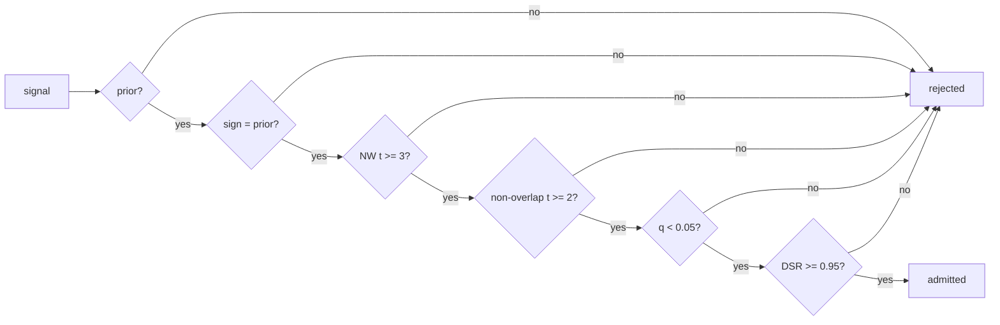
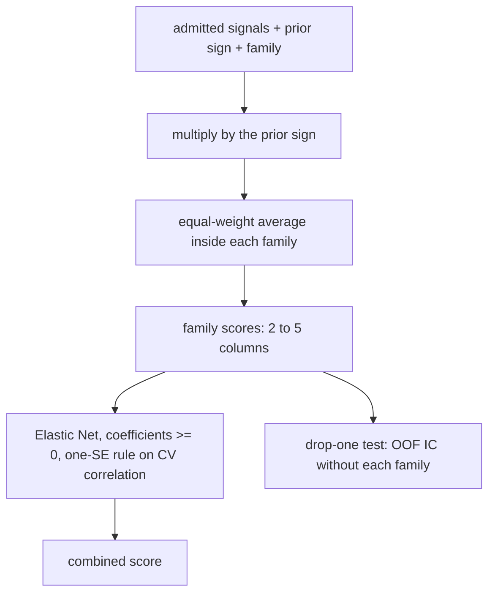
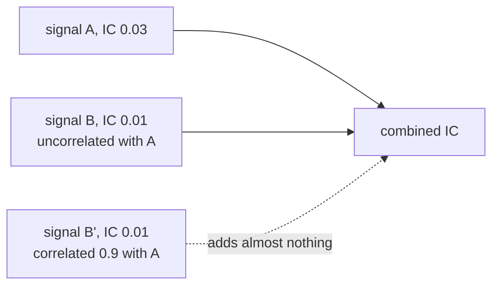

# Signal selection and combination (stages 05 and 06)

This page explains how a signal is admitted and how admitted signals are combined. This is the most important
step of the project: a weak selection turns noise into a backtest that looks good.

## 1. Principle

Many signals are tried. The best of many tries looks good even when all are useless. The defence has two parts:

1. A hard admission test. Few signals pass. Passing nothing is a valid result.
2. A small, fixed-structure combination. Few free numbers, so little to overfit.

## 2. The six gates (stage 05, default `--mode strict`)

| Gate | Test | Failure it catches |
|---|---|---|
| prior | family, sign and rationale written in `src/signals/priors.py` before the data | a pattern with no story (data mining) |
| sign | sign of the mean IC equals the prior sign | a pattern in the wrong direction |
| t_nw | sign-aligned Newey-West t >= 3 | multiple testing (Harvey, Liu, Zhu 2016) |
| t_nonov | sign-aligned t on one IC every h days >= 2 | an overlap correction that is too weak |
| fdr | q-value < 0.05 | share of false discoveries |
| dsr | deflated Sharpe >= 0.95 | the best of N tries is biased upwards |

Each gate has a command-line option in stage 05. The file `selection_gates.parquet` shows, for every signal,
which gate stopped it first. `--mode legacy` keeps the old rule (q < alpha) for exploration only.

### Deflated Sharpe ratio (short)

The series is the daily IC of the signal, sign-aligned, one value every h days. SR0 is the best Sharpe that
N skill-less trials are expected to reach. DSR is the probability that the true Sharpe exceeds SR0.
N counts all signals of the run plus `--n_trials_extra` (signals tried and removed earlier).
Details and limits: `src/evaluation/signals/dsr.py`.

## 3. Combination (stage 06, family mode)

- Signs come from the priors, not from the sample.
- Equal weights inside a family have no estimation error.
- Non-negative weights keep the economic sign.
- The one-standard-error rule picks the strongest shrinkage that is still within one standard error of the best
  CV correlation. If nothing beats zero by more than one standard error, all weights are zero and 06 stops.
- The drop-one test refits without each family and reports the change of the out-of-fold IC.

The old (1 - q) column weights are off in family mode: the hard gates replace them.

## 4. A weak signal that diversifies

A linear combination does not weight a signal by its own IC alone. The best weights depend on how the signals correlate.

- Combining two uncorrelated signals gives an IC about sqrt(IC_A^2 + IC_B^2): 0.0316 instead of 0.03.
- A signal correlated 0.9 with an existing one adds almost nothing, even if it is strong alone.
- So a weak but uncorrelated signal can deserve weight. A strong but redundant one may not.

Honest status: the strict gates (section 2) test each signal ALONE. A weak diversifier fails them and is rejected before the combiner sees it. The drop-one test (section 3) measures marginal value, but only for admitted signals. To admit a weak diversifier you need a separate rule with its own written prior (for example: IC t of at least 2, correlation with admitted signals below 0.3). That rule is not built. I wrote earlier that such a signal is "kept automatically"; that was wrong for strict mode.

## 5. What passing the gates does not prove

- The data are survivors (current S&P 500 members). Survivorship favours low-volatility and size-related signals.
- The gates control luck among the signals tried. They do not control a wrong data set.
- The holdout (last 200 dates) is the only clean test. Judge the strategy there.