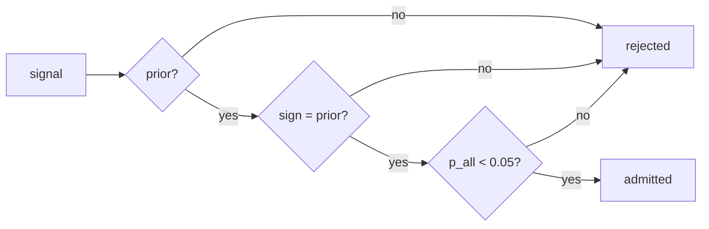
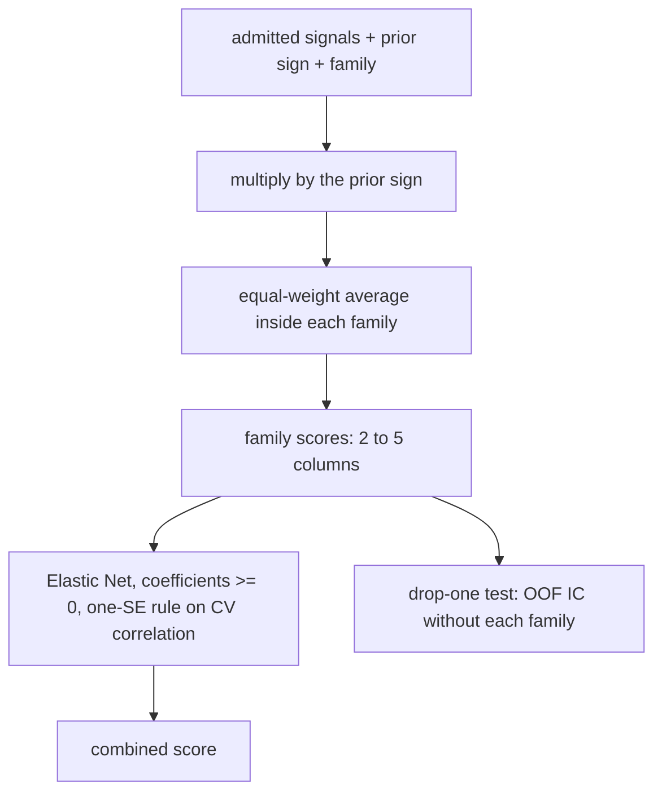
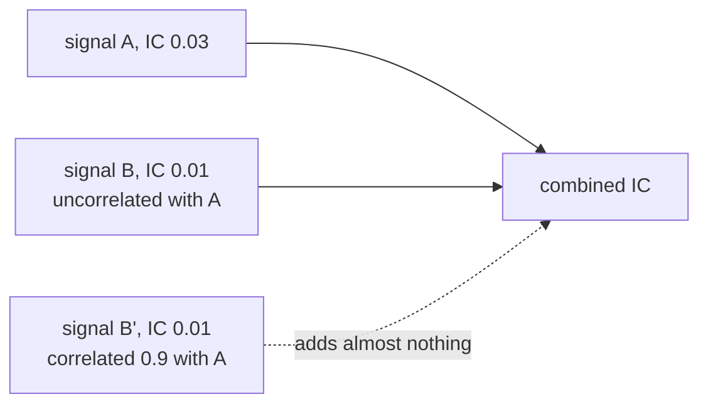

# Signal selection and combination (stages 05 and 06)

This page explains how a signal is admitted and how admitted signals are combined. This is the most important
step of the project: a weak selection turns noise into a backtest that looks good.

## 1. Principle

Many signals are tried. The best of many tries looks good even when all are useless. The defence has two parts:

1. A hard admission test. Few signals pass. Passing nothing is a valid result.
2. A small, fixed-structure combination. Few free numbers, so little to overfit.

## 2. The three gates (stage 05, default `--mode strict`)

| Gate | Test | Failure it catches |
|---|---|---|
| prior | family, sign and rationale written in `src/signals/priors.py` | a pattern with no story (data mining) |
| sign | sign of the mean IC equals the prior sign | a pattern in the wrong direction |
| fwer | p_all = min(1, p_RW x (K + n_trials_extra) / K) < 0.05 | luck among all the signals tried |

**p_RW, step by step** (`src/evaluation/signals/bootstrap.py`):

1. Daily rank IC of each signal on the search period. The series has memory: labels of neighbour days share h - 1 days, and a slow signal adds more.
2. Stationary block bootstrap (Politis-Romano). The mean block length comes from the data (Politis-White) and is at least h. The SAME resampled days are used for all signals, so the bootstrap keeps their correlation.
3. Studentized ("percentile-t"): t = mean IC / se, and t* = (mean* - mean) / se* in every resample. The se is a batch-means standard error, recomputed in each resample.
4. One-sided in the prior direction. A signal without a prior is tested two-sided.
5. Romano-Wolf step-down on the maximum of t* across the signals. Admitting with p_RW < 5% means: the chance that ANY admitted signal is luck is below 5% (family-wise error rate).

**Earlier runs.** Romano-Wolf sees only the K signals of this run. `--n_trials_extra` counts the signals tried before on the same data. If each earlier run was tested the same way, the trials form (K + n_trials_extra) / K families, and the Bonferroni bound over families gives the factor in p_all.

**Why these tests and not the old ones.** `scripts/research/calibrate_tests.py` simulates IC series with a known truth (10 years, h = 20, IC std 0.15, 300 series per cell):

| Signal memory | Newey-West | Non-overlapping t | Bootstrap (gate) |
|---|---|---|---|
| 1 day | 8.7% | 6.3% | 3.7% |
| 20 days | 9.7% | 11.7% | 4.3% |
| 60 days | 22.0% | 31.0% | 4.3% |

The nominal level is 5% everywhere. Newey-West and the non-overlapping t say "significant" up to 4 to 6 times too often on slow signals. The bootstrap keeps 5%, with about the same power on real signals (IC 0.02: 24% against 26% for Newey-West). With 10 correlated signals, a fixed-se bootstrap gave a family-wise error of 17%; the studentized one gives 4 to 5% (`tests/test_bootstrap.py`).

The deflated Sharpe ratio was a gate before. It keeps one IC every h days (95% of the data dropped at h = 20), and on the synthetic market it rejected planted effects that Romano-Wolf found. It is still printed.

**Cross-checks (printed, they decide nothing):** Newey-West t, non-overlapping t, BH / BY / Storey q-value, deflated Sharpe ratio, IC decay, IC by year. A big disagreement with the gates is a warning sign. The file `selection_gates.parquet` has every number. `--mode legacy` keeps the old rule (q < alpha) for exploration only.

## 3. Combination (stage 06, family mode)

- Signs come from the priors, not from the sample.
- Equal weights inside a family have no estimation error.
- Non-negative weights keep the economic sign.
- The one-standard-error rule picks the strongest shrinkage that is still within one standard error of the best
  CV correlation. If nothing beats zero by more than one standard error, all weights are zero and 06 stops.
- The drop-one test refits without each family and reports the change of the out-of-fold IC.

The old (1 - q) column weights are off in family mode: the hard gates replace them.

## 4. A weak signal that diversifies

A linear combination does not weight a signal by its own IC alone. The best weights depend on how the signals correlate.

- Combining two uncorrelated signals gives an IC about sqrt(IC_A^2 + IC_B^2): 0.0316 instead of 0.03.
- A signal correlated 0.9 with an existing one adds almost nothing, even if it is strong alone.
- So a weak but uncorrelated signal can deserve weight. A strong but redundant one may not.

Honest status: the gates (section 2) test each signal ALONE. A weak diversifier fails them and is rejected before the combiner sees it. The drop-one test (section 3) measures marginal value, but only for admitted signals. To admit a weak diversifier you need a separate rule with its own written prior (for example: IC t of at least 2, correlation with admitted signals below 0.3). That rule is not built. I wrote earlier that such a signal is "kept automatically"; that was wrong for strict mode.

## 5. What passing the gates does not prove

- The data are survivors (current S&P 500 members). Survivorship favours low-volatility and size-related signals.
- The gates control luck among the signals tried. They do not control a wrong data set.
- The holdout (last `HOLDOUT_DATES` = 756 dates, 3 years) is the only clean test. Judge the strategy there.