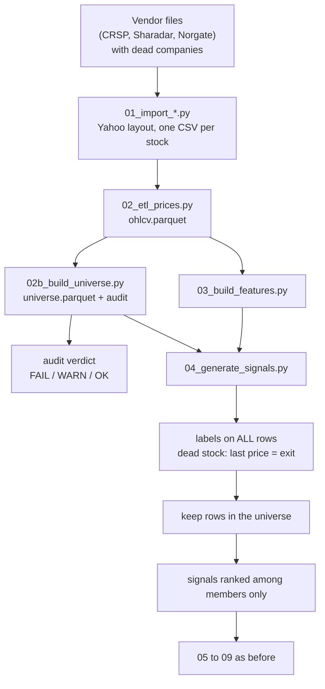

# Survivorship bias: the problem and the fix

Style: short sentences, no LaTeX.

## 1. The problem

A list of **today's** S&P 500 members, applied to the year 2000, has only companies that survived and grew.
The bankrupt, the bought and the demoted are missing. Two things go wrong.

| # | What is wrong | Who can fix it |
|---|---|---|
| 1 | The **prices of dead companies** are missing. Their losses are never traded. | Only a data vendor that keeps them. No script can invent them. |
| 2 | The **universe** of each date is chosen with hindsight. "Stocks that will be in the index" are winners. | Code. A rule on past data, or a point-in-time index list. |
| 3 | The **last days of a dead stock** have no label (a forward return needs future rows). Its final crash is never measured. | Code. Fixed in stage 04: the last price is the exit price. |

The code in this repository solves 2 and 3, and checks 1. For 1 you need data. The honest answer to
"a script that solves it perfectly" is: **the script is the machinery. The data of the dead companies must be bought or
borrowed.** Without them, no script is correct.

## 2. Where to get data of the dead companies

| Source | Dead companies | Index history | Cost | Fit |
|---|---|---|---|---|
| **CRSP through WRDS** | yes, since 1925, delisting returns included | S&P 500 list available | **free with your EPFL account** (the EPFL library lists CRSP, Compustat, IBES on WRDS; new users need an `@epfl.ch` address) | **best choice for you.** The importer is `01_import_crsp.py`. |
| Sharadar (Nasdaq Data Link) | yes ("active and delisted tickers") | S&P 500 table | paid subscription (check the price on their site) | good if WRDS is not enough. Preset `sharadar` exists, untested on a real file. |
| Norgate Data | **Platinum** and Diamond only | Platinum and Diamond | Platinum 630 USD per 12 months (July 2026 page) | good, cheap. Silver and Gold have NO delisted names. |
| Yahoo Finance | **no** | no | free | the cause of the problem. Fine for the synthetic checks and for testing code. |

Facts checked on the vendors' pages on 2026-11-26 (EPFL library, Norgate package page, QuantRocket page on Sharadar).
Prices change: confirm before you buy.

**A word on "live".** Real-time updates of dead-company data are not free either, but you do not need them. A backtest
needs history. CRSP is updated monthly with a delay. The research loop works with CRSP; for live trading you
would use another feed for the current prices.

## 3. "As if we had it live": the point-in-time universe

The idea: on each date, the universe is a **rule that uses only data up to that date**.

    every 21 trading days:   rank all stocks by their 60-day average dollar volume
                             keep the top N (default 1000) with at least 1 million dollars per day
    in between:              keep that set; a stock that stops trading leaves by itself

- No index list is needed. No hindsight: a stock enters only when its past volume says so.
- A stock that dies stays in the universe up to its last day, and its delisting return is in the data.
- Dollar volume is used and not price, because the price in the file is adjusted for splits to today's share count.

An index list (S&P 500 additions and removals) can be used instead (`universe_mode = "membership"`).
It is more faithful to "the S&P 500", but it is a committee decision, and the file must include the dead names too.

**Warning on the illiquidity signal.** A universe made of the top N by dollar volume cuts the liquidity range.
It weakens any signal built on volume (`log_adv`). In the synthetic lab the planted illiquidity effect disappears from the
top-200 universe. If you want to study illiquidity, use a wide universe (a large N, or a market-cap floor).

## 4. What the pipeline does with it



| Stage | Change |
|---|---|
| `01_import_crsp.py` | new. Downloads CRSP from WRDS in the Yahoo layout. `--probe` prints the real column names. |
| `02b_build_universe.py` | new. Writes `universe.parquet` and `universe_audit.json`. Modes: `all`, `rule`, `membership`. |
| `04_generate_signals.py` | labels first (dead stock keeps its last adjusted close as exit price), then the universe filter, then the signals. |
| `02_etl_prices.py` | the check "Adj Close above Close" ignores the last row of each stock (a take-over premium). |
| 05 to 09 | unchanged. |

The delisting return is part of the **last adjusted close**. The backtest holds a dead stock until the next
rebalance with the price frozen at that last value. Tested on the synthetic market: the last open-to-open return of a dead
stock equals its delisting return (correlation 0.9996).

## 5. The audit (what it can and cannot tell you)

`02b` prints a verdict:

| Verdict | Meaning |
|---|---|
| FAIL | no ticker stops trading before the end of the data. The file is survivors only. |
| WARN | fewer than 10% dead tickers after 10 years, or a median delisting rate below 1% a year, or almost no delisting crashes. The file is probably incomplete. |
| OK | dead tickers at a plausible rate. |

The audit catches the typical failures. It **cannot prove** that the file is complete.

## 6. The lab: how big is the bias?

`python scripts/demos/survivorship_lab.py` (about 5 minutes). One synthetic market with delistings (26% of the stocks die;
the risk is higher after a bad year). Three versions go through the same stages:

| | SURV (survivors only) | FULL (dead stocks included) | PIT (dead stocks, top 200 by volume) |
|---|---|---|---|
| audit verdict | **FAIL** | OK | OK |
| mean IC momentum 252 | 0.029 | 0.037 | 0.037 |
| mean IC volatility 252 | -0.024 | -0.032 | -0.029 |
| Sharpe gross, full sample | 1.09 | 1.63 | 1.67 |

Read it with care:
- It is **one seed**. The table shows that the machinery measures a gap. It does not give the size of the real bias.
- In this market the dead stocks fell and then crashed, so a long-short book that shorts losers loses part of its profit
  when they are removed. On real data with a back-filled index list the usual direction is the opposite for long-only
  books. The direction depends on the market. What does not depend on it: the survivors-only file changes the answer.
- The net Sharpe is noisy (0.87, 0.63, 0.87) and should not be compared across the three versions.

## 7. How to run it on real data (CRSP)

```bash
pip install wrds
# config/dataset_config.json:
#   {"source": "crsp", "asset": "equities", "region": "US", "universe": "USALLCAP", "freq": "daily",
#    "universe_mode": "rule", "universe_rule": {"top_n": 1000}}
python scripts/pipeline/01_import_crsp.py --probe                       # check the column names once
python scripts/pipeline/01_import_crsp.py --wrds_user YOURNAME --start 1999-01-01 --end 2026-11-20 --min_cap 200000
python scripts/pipeline/02_etl_prices.py
python scripts/pipeline/02b_build_universe.py                           # read the VERDICT
python scripts/pipeline/03_build_features.py
python scripts/pipeline/run_experiment.py --date 2026-11-26 --tag crsp
```

## 8. Limits

- `01_import_crsp.py` is **not tested against a live WRDS account**. The table and column names come from my memory of
  public documentation of the new CRSP format (CIZ). I could not open CRSP's own guide to confirm them, nor the claim that
  the delisting return sits inside `dlyret` of the last day. `--probe` and the column check exist for this reason. The conversion code is tested
  on fake tables (`tests/test_crsp.py`).
- WRDS states that the December 2024 data is the last release in the old format (SIZ). The new table `crsp.dsf_v2` is my best knowledge of the replacement (unconfirmed).
- CRSP data is licensed. Do not publish it. `data/` stays out of git.
- A delisting for cause with no known return gets an **assumed -30%** (Shumway 1997). It is counted in the report.
- Market capitalisation, point-in-time fundamentals and the S&P 500 list are not used yet. Fundamentals need Compustat
  with reporting lags.
- A ticker is not an identity. The same ticker can belong to two companies. The importer names files `TICKER_PERMNO`.
- Nasdaq volume before 2004 counted dealer trades twice. The importer divides it (Gao and Ritter 2010).
- Sharadar and Norgate presets are written from documentation and are not tested on real files.

## 9. References

- Shumway, T. (1997). The delisting bias in CRSP data. Journal of Finance, 52(1).
- Shumway, T. and Warther, V. (1999). The delisting bias in CRSP's Nasdaq data. Journal of Finance, 54(6).
- Gao, X. and Ritter, J. (2010). The marketing of seasoned equity offerings. Journal of Financial Economics (Nasdaq volume adjustment).
- Elton, E., Gruber, M. and Blake, C. (1996). Survivorship bias and mutual fund performance. Review of Financial Studies, 9(4).
