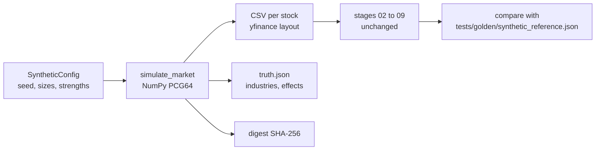

# Synthetic market (a dataset with a known truth)

## Why

On real data the right answer is unknown. A pipeline that finds a signal may be right, or may be fooled.
The synthetic market is a fake market where **we decide what is predictable**. It has three uses:

1. **Test the chain.** The planted effects must be found. Nothing else may pass the gates.
2. **Compare machines.** The same seed gives the same data on every machine. Two people can run the
   same pipeline and compare numbers (the reference run, below).
3. **Check the clusters and the betas.** The industries and the true betas are known.

It cannot say anything about **real** alpha. The strengths are assumptions.

## The model

Daily log return of stock i:

    r = beta_i x market + gamma_i x industry factor + sigma_i x noise (Student t, 5 dof) + planted drift

| Planted effect | How | Expected prior |
|---|---|---|
| Low volatility | `sigma_i` grows with a fixed attribute; drift `-c_vol x z_vol` | vol signals, sign -1 |
| Illiquidity | volume grows with a fixed attribute; drift `-c_liq x z_liq` | log_adv signals, sign -1 |
| Short-term reversal | drift `-c_rev x` z-score of the past 5-day return | mom5, sign -1 |
| Momentum | drift `+c_mom x` z-score of the return from t-252 to t-21 | mom120 / mom252, sign +1 |

Prices follow the yfinance layout (Date, Adj Close, Close, High, Low, Open, Volume). `Close` is adjusted for
splits only, `Adj Close` also for dividends. There are no delistings: this market has **no survivorship bias**.
Source: `src/data/synthetic.py` (the header explains every number).



## How to run

The dataset is chosen by the environment variable `QAL_DATASET_CONFIG`. The reference script sets it itself.

```bash
python scripts/demos/run_synthetic_reference.py            # 2 to 4 minutes: simulate, run 02 to 09, compare
python scripts/demos/make_synthetic_market.py              # only write the CSV files (needs the variable below)
export QAL_DATASET_CONFIG=config/dataset_synthetic.json    # to run single stages on the synthetic data
unset QAL_DATASET_CONFIG                                   # back to the real data
```

Synthetic data go to `data/raw/synthetic/...` and `data/clean/equities/US/SYNTH/...`. Real data are never touched.

## The reference comparison

`run_synthetic_reference.py` collects about a dozen numbers and compares them with
`tests/golden/synthetic_reference.json`. Each number has a rule:

| Rule | Meaning |
|---|---|
| exact | same value (lists of admitted signals and families) |
| abs | within an absolute tolerance (Sharpe, IC, beta, cost) |
| max | must stay below a bound (beta exposure after neutralising: about 1e-14) |

If a number fails on another machine, first run `python -m pytest tests -q`, then send the printed table.
Small differences in the last digits are normal (BLAS, library versions). A different **list of admitted signals** is not.

To change the golden file on purpose (a code change you accept): `python scripts/demos/run_synthetic_reference.py --update-golden`,
then commit the new file with a message that says why.

## What the reference run shows (seed 12345, 300 stocks, 10 years)

- Admitted: the volatility, illiquidity and momentum families. The 5-day reversal fails the DSR gate (t is large, the sample is short).
- Clusters: 7.8 on average for 8 true industries. Adjusted Rand index 1.0 against the truth.
- Beta-neutral book: realised beta 0.009 (t 0.7).
- Sharpe: gross 1.49, net 0.50. Costs about 684 bps per year at turnover near 20x. **Costs eat two thirds of the gross Sharpe.**
  This is the next thing to fix (cost-aware construction).
- Alpha after the market: +3.4% per year, t = 1.3. Not significant alone: ten years of a 0.5 Sharpe is a weak test.
- Year by year: 6 of 10 years positive after costs. A single year can be -14%.

Read it as a test of the **machinery**, not as a promise of returns.
